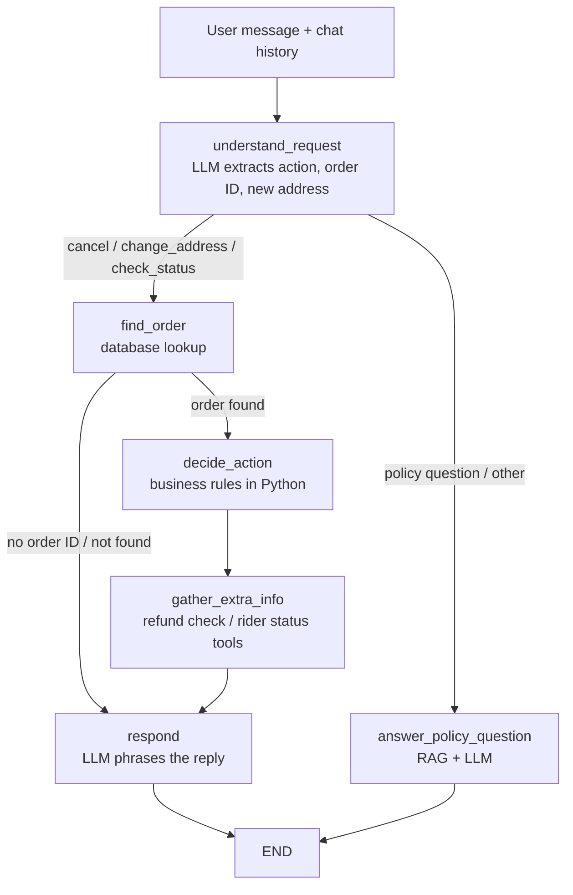

# 🍔 Foodpanda-Style AI Support Agent

A mock food-delivery platform with an **AI customer-support agent** that handles everything in plain English: cancelling orders, changing delivery addresses, tracking order and rider status, answering policy questions, handling requests with more than one part, and responding politely to off-topic questions.

It is built with **LangChain**, **LangGraph**, **Google Gemini**, **SQLite**, **ChromaDB (RAG)** and **Streamlit**.

> **Core idea:** the LLM *understands* the request and *phrases* the reply, but it never *decides* anything. Whether an order can be cancelled or an address changed is decided by plain Python business rules checked against the real database. This prevents the model from inventing answers or wrongly promising a cancellation.

---

## Why I built this project

This project comes from a problem I ran into myself while ordering on Foodpanda.

- **Changing the address:** if you forget to update your delivery address before placing an order, there is no option in the app to change it afterwards. You have to wait until a rider picks up the order and then message the rider, which is slow, confusing and often leads to a mess (wrong location, delays, or a failed delivery).
- **Cancelling an order:** if you want to cancel an order, there is no clear option to do it.

Both should be simple actions with clear rules: allowed while the order is still being prepared, and blocked once it is on the way. So I built an AI support agent that lets a customer just say "Change my address" or "Cancel my order" in plain English and get an immediate, correct answer.

A plain chatbot could "talk its way" into a plausible answer without checking the real order. It might promise a cancellation that isn't allowed. So I designed the agent so that:

- the **LLM only understands and explains**, and never decides
- every action is **checked against real data** in the database
- the **business rules live in code**, so the same request always gets the same answer
- policy questions are answered **only from the policy documents I wrote** (RAG), not from guesses

It was also a hands-on way to learn and combine **LangChain** (tools), **LangGraph** (workflow and routing), **RAG** (ChromaDB) and **Streamlit** in one working end-to-end application.

## What the agent can do

| Capability | Example message | What the agent does |
|---|---|---|
| **Cancel an order** | "Cancel my order ORD1001" | Order is `preparing`, so it cancels it and reports a 50% refund |
| **Blocked cancellation** | "I want to cancel ORD1002" | Order is `out_for_delivery`, so it explains it can no longer be cancelled |
| **Change address** | "Change my address for ORD1004" | Asks for the new address, then updates it if the order is `placed` or `preparing` |
| **Track order status** | "Where is my order ORD1002?" | Looks up the order and reports its status and the rider's status |
| **Compound requests** | "Cancel it, and if you can't, change the address" | Handles the first request, and if it is blocked, explains that the same rule blocks the address change too |
| **Policy questions** | "What happens if my order is really late?" | Answers from my own sample policy documents (RAG), not Foodpanda's real policies |
| **Off-topic questions** | "What toppings does Pizza Hut have?" | Replies politely that it has no information on that and points to support, instead of making something up |
| **Multi-message conversations** | "I want to cancel my order" → "ORD1004" | Remembers the earlier intent, so you don't repeat yourself |
| **Errors and edge cases** | "Cancel ORD9999", or a cancelled order | Reports that the order wasn't found, or that a cancelled order can't be changed again |

## Features

- **AI support chat** with natural-language understanding (Gemini)
- **Order and rider tracking** through chat, plus a Track Order page showing the delivery address
- **Compound requests:** a message asking for two things (cancel, otherwise change the address) is handled sensibly
- **Safe off-topic handling:** unrelated questions get a polite "I don't have information on that" instead of an invented answer
- **Rule-based actions:** cancel orders and change addresses only while the order is `placed` or `preparing`
- **Automatic refund check** after a cancellation (full refund if `placed`, 50% if `preparing`)
- **Short-term memory:** the last 8 chat messages are passed to the agent, so follow-ups such as just an order ID or address work
- **RAG over policy documents:** refund, cancellation, delivery-delay and tipping policies are chunked, embedded and searched by meaning
- **Relevance cutoff:** off-topic questions don't get random policy text
- **Full demo app:** browse restaurants and menus, add to cart, place orders, track orders, read reviews
- **Test suites:** single-message scenarios and multi-turn conversation tests

## How the agent works

Every chat message runs through a LangGraph workflow:



| Node | Uses LLM? | Job |
|---|---|---|
| `understand_request` | Yes | Reads the message and history, returns the action, order ID and new address as JSON |
| `find_order` | No | Looks the order up in SQLite |
| `decide_action` | **No** | Applies the business rules and performs the cancel or address update |
| `gather_extra_info` | No | Calls LangChain tools for refund info (after cancel) or rider status (after status check) |
| `respond` | Yes | Turns a result code into a friendly reply, told exactly what the result means so it can't invent reasons |
| `answer_policy_question` | Yes | Retrieves policy text with `search_policy` and answers **only** from it |

Result codes such as `cancelled`, `cancel_blocked`, `address_updated`, `address_blocked`, `already_cancelled`, `no_order_id` and `order_not_found` carry the outcome between nodes.

## Business rules

- Orders can be cancelled while `placed` or `preparing`
- Delivery address can be changed while `placed` or `preparing`
- A cancelled order cannot be changed or cancelled again
- Refunds: full if cancelled while `placed`, 50% if cancelled while `preparing`, none needed for unpaid cash-on-delivery orders

## RAG (policy knowledge base)

> **Note:** the policies used here are **not Foodpanda's real policies**. I wrote these policy documents myself as sample content for this project. Any refund amounts, time limits or rules in them are made up for demonstration.

1. Four policy documents are written to `policies/` (refund, cancellation, delivery delay, tipping)
2. Each document is split into paragraphs, and every chunk keeps its policy title (for example `Refund Policy: ...`)
3. `chromadb` embeds the chunks with its built-in local model (no Gemini quota used) and stores them in `chroma_db/`
4. `search_policy` retrieves the closest chunks and ignores any with distance ≥ `MAX_DISTANCE` (default `1.2`)
5. The LLM answers using only the retrieved text, or says it doesn't have that information

## Database

SQLite file `foodpanda.db` with five tables:

| Table | Contents |
|---|---|
| `orders` | Order ID, customer, restaurant, items, status, address, rider, payment status, time, total |
| `restaurants` | Name, cuisine, rating, delivery time, address |
| `menu_items` | Items per restaurant with description, price and category |
| `cart_items` | Items in a user's cart |
| `reviews` | Ratings and comments per restaurant |

Sample data (4 orders, 5 restaurants, 8 menu items, reviews) is included, and `reset_database()` restores it, which keeps tests repeatable.

## Streamlit app

| Tab | What it does |
|---|---|
| Browse Restaurants | Search, filter by cuisine, view menus and reviews, add to cart |
| Cart | View cart, enter name and address, place order |
| Track Order | Enter an order ID to see status, rider, payment and a progress bar |
| AI Support | Chat with the agent (with memory) |

All tabs share the same database, so an order cancelled in the chat shows as cancelled in Track Order.

## Project structure

The notebook generates these files:

```
foodpanda-ai-agent/
├── foodpanda_ai_agent.ipynb   # Full step-by-step build (Phases 1-25)
├── db_functions.py            # Plain Python DB functions (orders, restaurants, menu, cart, reviews)
├── tools.py                   # LangChain tools + business rules + search_policy (RAG)
├── state.py                   # SupportState shared by all graph nodes
├── nodes.py                   # Graph nodes
├── graph.py                   # LangGraph workflow and conditional edges
├── app.py                     # Streamlit app
├── policies/                  # Sample policy documents I wrote for RAG (not real Foodpanda policies)
├── foodpanda.db               # SQLite database (generated)
├── chroma_db/                 # Vector store (generated)
├── requirements.txt
└── README.md
```

## Notebook phases

| Phase | Topic |
|---|---|
| 1 | Project setup (Google Colab + Drive) |
| 2-3 | SQLite database, sample data and backend functions |
| 4 | LangChain tools with business rules |
| 5-6 | Connecting Gemini and a manual tool-calling workflow (showing its limits) |
| 8 | LangGraph state (`SupportState`) |
| 9-12 | Nodes, edges, conditional routing and tool calls inside the graph |
| 13-14 | Chat interface with history and test scenarios |
| 16-17 | Restaurants, menu, cart and review tables and functions |
| 18-20 | Streamlit app, order tracking and AI chat integration |
| 21-23 | Policy documents, chunking and embeddings, RAG tool and routing |
| 24 | Multi-turn conversation tests |
| 25 | Launching the demo app through a public tunnel |

## Getting started

### Option 1: Google Colab (recommended)

1. Open `foodpanda_ai_agent.ipynb` in Google Colab
2. Run the cells in order (this creates the database, all `.py` files, the policies and the vector store)
3. Paste your [Gemini API key](https://aistudio.google.com/app/apikey) when asked in Phase 5
4. Test with `ask_support_agent("Cancel my order ORD1001")`
5. Run Phase 25 to launch the Streamlit app and open the public `trycloudflare.com` link

### Option 2: Run locally

1. Run the notebook once (or copy the generated files) so `foodpanda.db`, `chroma_db/` and the `.py` files exist in one folder
2. Then:

```bash
pip install -r requirements.txt
export GOOGLE_API_KEY="your-key"     # Windows: set GOOGLE_API_KEY=your-key
streamlit run app.py
```

> The notebook uses Colab paths (`/content/drive/MyDrive/foodpanda-ai-agent`). Change them if you run it elsewhere.

## Tech stack

Python · LangChain · LangGraph · Google Gemini (`gemini-flash-lite-latest`) · SQLite · ChromaDB · Streamlit · cloudflared (tunnel for Colab)

## Known limitations

- Memory is short-term only (history text is passed to each run, with no checkpointer)
- Order IDs must match exactly (for example `ORD1002`, not `1002`)
- Menu questions are answered with "no information" rather than from menu data
- Mock data and self-written sample policies only, with no real Foodpanda data, policies or integration, and no real payments or authentication (the demo uses a fixed user ID)

## Possible next steps

- Checkpoint-based conversation memory
- Menu and restaurant data in the RAG knowledge base
- Fuzzy order-ID matching
- User login and per-user order lists
